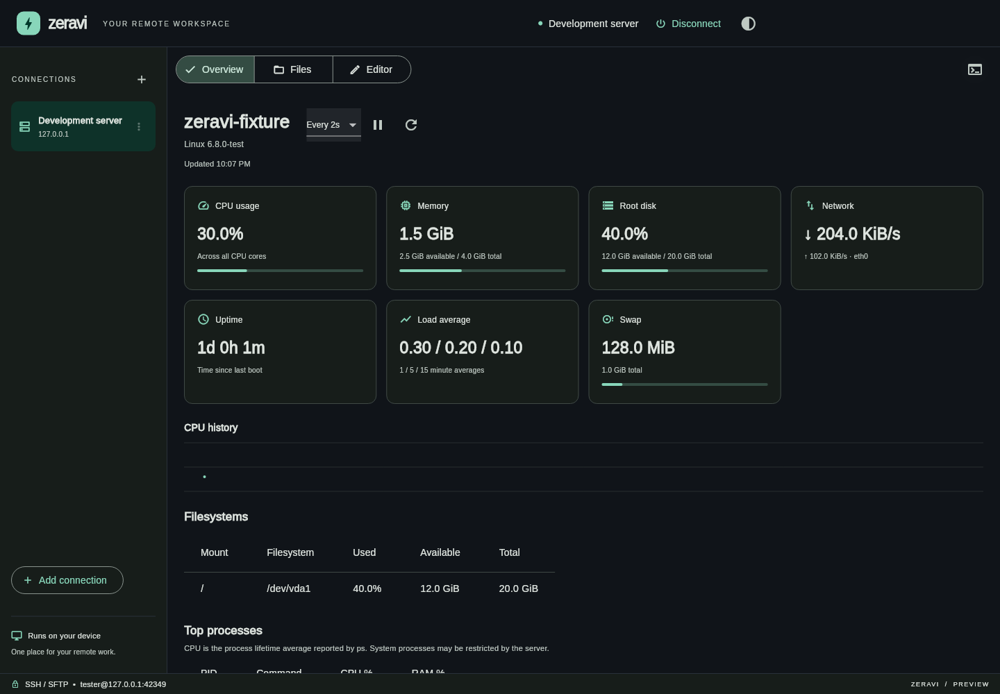
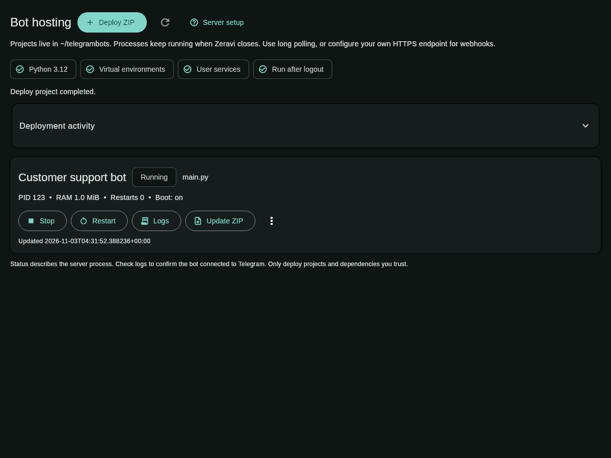
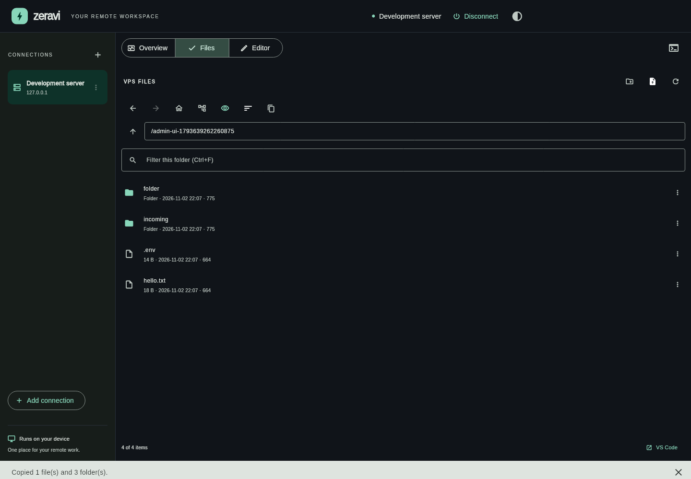

# Zeravi

A local Flutter desktop workspace for remote Linux servers. Connect through SSH,
browse remote files, use your system file manager for transfers, open terminals,
and keep an eye on the server from one app.

**Preview · Ubuntu Linux x64 is the tested target.** Other platform folders are
Flutter scaffolding; a web build is not supported.



*Screenshots use a disposable test server with synthetic monitoring data.*

## What is included

- **Bots:** deploy Python Telegram bot ZIPs, install requirements in isolated virtual
  environments, manage persistent services, logs, environment variables and rollbacks.
- Saved SSH profiles, key/password authentication and explicit host-key trust.
- **Overview:** live CPU history, RAM, swap, load, uptime and interface traffic.
- Filesystem capacity and top-process views, with refresh/pause/polling controls.
- A VPS file browser that works with Nautilus instead of duplicating local Files.
- Native incoming file/folder drops, including drops onto remote folder rows.
- Native outgoing file/folder copies using completed local export staging.
- Recursive transfers, empty folders, overwrite/merge confirmation and progress.
- Sort by name, size, modification time or type; descending order and folders first.
- Hidden-file and compact-row toggles, file properties and copy-path actions.
- Back/forward, parent, home and root navigation, plus keyboard shortcuts.
- Saved grid/list views and real right-click file/folder menus.
- A resizable right-side terminal dock, resizable editor explorer and connections.
- Collapsible connections, terminal maximize/restore, and layout reset.
- Multiple independent SSH terminals and a UTF-8 text editor with conflict checks.
- Open remote paths in local VS Code using saved SSH details or an existing alias.
- Persisted theme, browser settings, monitoring interval and terminal visibility.

## Run on Ubuntu

Tested with **Flutter 3.47.7 / Dart 3.13.5**. Install Flutter's Linux desktop
prerequisites (Clang, CMake, Ninja, pkg-config and GTK development libraries), then:

```sh
flutter doctor -v
flutter pub get
flutter run -d linux
```

Native drag-and-drop uses `super_drag_and_drop`, whose build integration uses
Rust or downloads its prebuilt native component when Rust is absent.

Choose **Add connection**, enter the server hostname/IP, port and username, and
select an existing private key or password authentication. Check the first-use
host fingerprint against your server console or administrator before trusting it.
Passwords and key passphrases are requested when connecting and are not saved.

## Python Telegram bot hosting



Connect to a VPS, open **Bots**, then **Deploy ZIP**. Include `requirements.txt`
and a Python entry point such as `main.py`. Configure your token as an environment
variable, choose persistent data folders, and deploy. Start, stop, restart, update,
inspect logs, edit settings, or roll back from the bot card. Projects are stored
in `~/telegrambots` on the VPS; **Open project in Files** takes you to editable code.

The VPS needs Python virtual environments, systemd user services and linger.
**Server setup** checks readiness and shows the one-time setup commands.
See [the hosting guide](docs/BOT_HOSTING.md) for prerequisites, deployment limits,
data storage, security and recovery.

## Daily workflow

**Overview** opens when connected. CPU percentages and network rates need two
samples. Missing server commands or restricted metrics remain unavailable; failed
refreshes leave the last successful reading visible with an error. Process CPU
is the lifetime average reported by `ps`. Polling is read-only and needs no root.

**Files** shows remote contents. Drag local files/folders from Nautilus onto the
browser or onto a remote folder row. To download, drag a remote item into Nautilus.
The native data provider downloads a complete export copy before supplying its
local file URI. Large exports take time: progress appears in Zeravi while the
file manager waits. **Export and reveal in Files** also prepares a local copy and
opens its containing folder, useful when a file manager times out during a large
drag. Sources stay intact; these operations are copies, never moves.

**Layout:** use the grid/list button in Files to choose a view. Drag the dividers
between connections, the editor explorer and the right-side terminal to resize
them. Double-click a divider to reset its width, or use **Reset layout** to restore
the default workspace. Collapse connections to an icon rail with the chevron or
Ctrl+B. Pane widths, view mode and collapsed state are remembered.

Right-click a remote folder and choose **Open in terminal** to create a focused
SSH tab in that folder. Files offer **Open parent in terminal**. The terminal
**+** button and Ctrl+Alt+T start a tab in the current explorer folder. Tabs show
folder names with full paths in tooltips. Terminal maximize/hide preserves the
existing shells.

**Editor** opens when a regular UTF-8 text file is selected. The preview supports
one file up to 1 MiB; use **Save** or **Ctrl+S**. Existing server changes are checked
before saving. Use **+** in the terminal bar for another SSH shell. Hiding the
terminal panel preserves its shells. Right-click copies a selection or pastes.

### Shortcuts

| Shortcut | Action |
| --- | --- |
| Ctrl+S | Save the open editor file |
| Ctrl+B | Collapse / expand connections |
| Ctrl+Alt+T | New terminal in the current remote folder |
| Ctrl+H | Toggle hidden files |
| Ctrl+L | Focus the remote path |
| Ctrl+F | Focus the file-name filter |
| F5 | Refresh the current remote folder |
| Alt+Left / Alt+Right | Back / forward |

### Open in VS Code

Install VS Code, make its `code` command available, and install **Remote - SSH**.
**Open in VS Code** uses the saved host, username, port and private-key path when
the optional alias is blank. Zeravi creates a metadata-only entry in
`~/.ssh/zeravi.conf`, adds an Include at the top of `~/.ssh/config`, and keeps an
initial `config.zeravi-backup` when an existing config needs that Include. Existing
manual Host entries remain intact. Passwords, passphrases and key contents are
never written. VS Code handles its own authentication prompts.

To use an existing custom SSH alias (for example one with jump-host settings),
enter it in **VS Code SSH alias**. That path uses your existing configuration
without generating an entry. Errors identify missing VS Code/Remote SSH or local
SSH configuration access instead of showing a raw “Bad state” message.



## Build and test

```sh
flutter analyze
flutter test
flutter build linux --release
./build/linux/x64/release/bundle/zeravi
```

Keep the executable together with the bundle's `lib` and `data` folders.
For real SSH checks, install `asyncssh` in a Python virtual environment and run:

```sh
python tool/test_ssh_server.py
```

It prints a temporary JSON path. Keep that loopback-only server running, and in
another terminal use the printed path:

```sh
flutter test --concurrency=1 \
  --dart-define=SSH_FIXTURE=/printed/path/fixture.json \
  test tool/workspace_preview_test.dart
```

The fixture uses generated keys, disposable files, synthetic monitoring data and
an echo-only shell. It never executes arbitrary test input as a system command.
Stop it with Ctrl+C. Default tests skip SSH checks when no fixture is supplied.
UI previews are generated in `build/previews/`. Widget tests disable the native
drag engine; they exercise incoming drop messages and the exact outgoing export
provider. A physical Nautilus drag is a separate desktop smoke check.

## Storage and current limits

Profiles, trusted fingerprints and preferences are stored in `zeravi.sqlite` in
the platform application-support directory. Passwords, passphrases and key
contents are not persisted. Keyring integration is planned.

Exports are retained in the application's `zeravi-exports` temporary directory
for up to 24 hours; stale copies are cleaned on a later export. This gives the
system file manager time to finish copying. Failed preparations do not publish a
URI. Symbolic links/special files are skipped and POSIX permissions are not
replicated. Each copied file is staged before replacement. Folder batches are
not transactions, and completed files remain after a later failure. Replacing
existing VPS files requires POSIX rename support.

The preview supports one connected server and one plain-text editor alongside
multiple shells. Editor checks and writes are not atomic; an interrupted editor
save can leave partial content. Changed host keys require manual investigation;
there is no reset-trust button. SSH agent/ProxyJump, transfer resume/cancellation,
general service administration, SSH tunnels, other deployment types and editor
tabs remain planned. Python bot deployment and its service/log controls are available
in Bots.

- [Expected desktop workflow and implemented checklist](docs/USER_EXPECTATIONS.md)
- [Architecture and data handling](docs/ARCHITECTURE.md)
- [Project plan](docs/PROJECT_PLAN.md)


## Debian installer

Build an Ubuntu installer with `python3 tool/build_deb.py`, then install the
resulting `.deb` from `build/packages/`. See [packaging and installation](docs/PACKAGING.md)
for requirements, update/removal instructions and the target-distribution limits.
